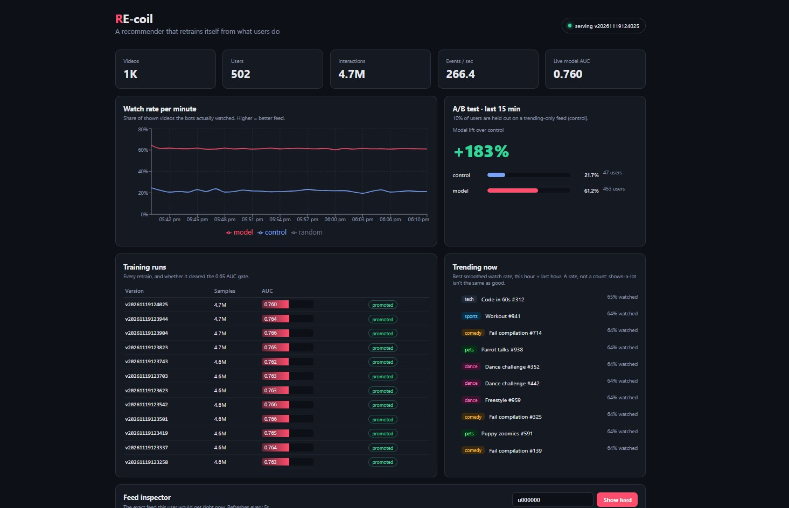
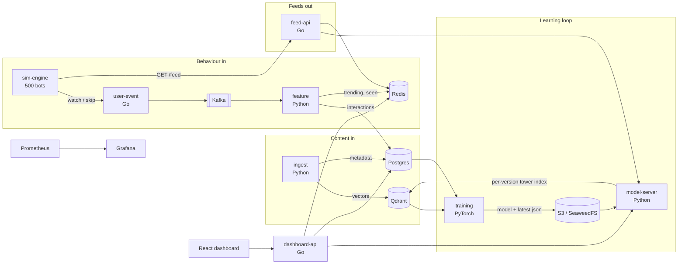
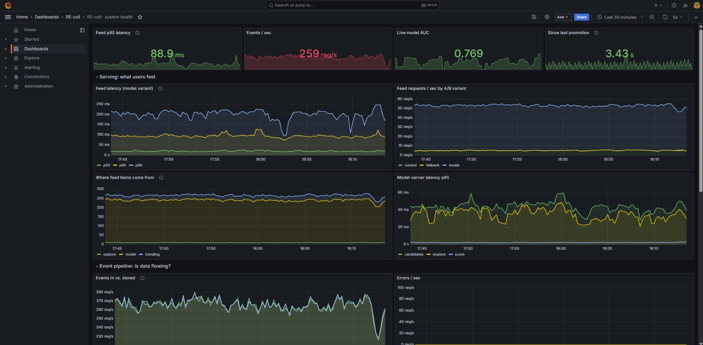

# RE-coil

A short-video recommender built end to end: videos go in, personalized feeds come out, and the ranking model retrains itself from what users do, with no human in the loop.

It's the same shape as a TikTok-style system: two-tower retrieval, a multi-stage ranking pipeline, a streaming retrain loop with a quality gate, an A/B holdout, and full observability. It runs on one laptop as a monorepo of services.


## Results



Measured on a live run with 500 simulated users and 1,000 videos:

|                                                     |                                                                   |
| --------------------------------------------------- | ----------------------------------------------------------------- |
| Watch rate, random feed (no model)                  | **21%**                                                           |
| Watch rate, self-trained model                      | **47%** at first promotion, **~61%** at steady state              |
| Theoretical ceiling with the diversity cap          | ~60% (see _Trade-offs_)                                           |
| A/B: model vs. trending-only control                | **61.3% vs. 21.7%** watch rate (**+182%** lift)                   |
| Validation AUC (champion re-scored on live data)    | **~0.76**                                                         |
| Model knows both of a user's hidden tastes          | **98.5%** of users                                                |
| Predicted vs. true watch probability (liked videos) | 0.72–0.74 vs. 0.75 (well calibrated)                              |
| Feed latency p95                                    | 230 ms → **~100 ms** after removing PyTorch from the request path |

Nobody tells the model what any user likes. Each simulated user secretly loves 2 of 10 categories; the system has to discover that from watches and skips alone.

## Architecture



**Stack:** Python 3.13 (FastAPI, PyTorch) for ML services · Go for the serving path · React + Vite dashboard · Kafka (KRaft) · Qdrant · Redis · Postgres · SeaweedFS (S3-compatible) · Prometheus + Grafana · Docker Compose.

## How it works

**Two-tower model.** One small network turns a user into a 64-number taste vector; another turns a video's content vector into 64 numbers in the same space. Their dot product is the score. Because the towers only meet at the very end, every video's vector is computed once and stored in Qdrant, and a request only computes the user's side. That's what makes searching the whole catalogue fast. Trained pointwise with binary cross-entropy on watched/skipped.

**Feed pipeline** (`feed-api`), the multi-stage funnel real recommenders use:

1. **Retrieval:** nearest neighbours to the user's vector in Qdrant (200 candidates), with recently seen videos filtered out inside the search.
2. **Ranking:** watch probability for every candidate plus trending videos.
3. **Re-ranking:** at most 2 videos per category, plus an **exploration** slot: the user's best guess from a category the feed isn't showing.

It degrades gracefully: no model yet, or model-server down, means a trending feed instead of an error.

**Retrain loop** (`training`). Every 30 s, if enough new interactions arrived: train on the most recent 200k events, then score **both the new model and the live model on the same validation rows**. Promote only if the new one clears an absolute AUC of 0.65 and isn't worse than the live one. Promotion just rewrites `latest.json`; the model-server hot-swaps to it with zero downtime (blue/green index per version).

**A/B holdout.** 10% of users, picked by hashing their ID so they never switch groups, get a trending-only feed. Both groups run at the same time, which makes the comparison fair in a way that before-and-after numbers can't be.

## What broke, and what I learned

The most useful part of this project was the bugs. Each one was caught by a test, a metric, or the dashboard.

1. **The first models couldn't pass the gate (AUC 0.54).** With ~17 events per user, 5 epochs at batch 512 meant only ~70 gradient updates. More steps and a higher learning rate fixed it, and the quality gate correctly refused to ship the bad models in the meantime.

2. **The loop froze: every new model was rejected.** The live model claimed AUC 0.81, and new ones scored ~0.75. But the 0.81 was measured when users saw _random_ videos (easy to predict); later data came from _personalized_ feeds (much harder). One fixed model scores 0.79 vs. 0.62 on the two kinds of data. AUCs from different data can't be compared. Fix: **champion vs. challenger** on identical rows. Re-scored fairly, the "0.81" champion was really 0.754, and the challenger won with 0.760.

3. **Different videos got identical scores.** The higher learning rate from bug 1 had killed **97.7% of the item tower's ReLU neurons**; only 416 of 1,000 videos kept a distinct vector. Switching to LeakyReLU at lr 0.003 restored all 1,000 and raised AUC on larger data from 0.70 to 0.81. A regression test now fails if two videos ever share a vector.

4. **Grafana showed feed p99 ~8× what I'd measured by hand.** The model-server called PyTorch on every request, and 20 concurrent requests plus the trainer fought over the CPU cores (0.37 ms alone, **106 ms p95** under load). All tower vectors are now precomputed when a model loads, so requests are a NumPy lookup and one matrix multiply: **0.3 ms p95**. `/score` dropped from ~200 ms to ~0 in production.



5. **I misdiagnosed a "filter bubble".** One user who likes comedy and music got only comedy, and I assumed the model hadn't learned music. A coverage metric against the bots' hidden tastes proved me wrong: the model _knew_ both tastes for 98.5% of users. Raw top-10 retrieval just showed both only 20.8% of the time, because same-category videos have similar vectors. That gap is the job of the category cap and exploration.

6. **Trending measured exposure, not quality.** It ranked by watch _count_, and the model shows comedy to comedy fans, so trending became mostly comedy and control users did worse than random (17% vs. 21%). It now ranks by **smoothed watch rate**, so a video shown 100 times and watched 60 beats one shown 1,000 times and watched 250.

7. After the fix, the control group rose from 17.1% to 21.7% (back to the random baseline) and trending spans six categories instead of mostly comedy. The A/B lift dropped from +257% to +182%: the old number was inflated by a handicapped control group.

8. **CLIP "improved" AUC from 0.765 to 0.83, and then it didn't.** The embedding swap briefly broke the feed, so bots watched near-random videos, which made the validation data easy. Once the feed recovered, AUC settled back at ~0.755. It was the same trap as #2, and I caught it because it had already caught me once.

## Trade-offs and honest limits

- **Engagement vs. variety.** With a 5-video feed, 2 liked categories and a cap of 2 per category, the best possible watch rate is ~60%, and the model reaches it. A cap of 3 would score higher with less variety. `MAX_PER_CATEGORY` is an env var.
- **Simulated users.** Signals come from bots with simple, fixed tastes, not people.
- **Single objective.** The model predicts one thing (watch or skip). Production systems predict several (likes, shares, follows, watch time) and blend them; that multi-task ranking head is the biggest gap between this and the real thing.
- **Text-only content understanding.** Videos are embedded with CLIP (ViT-B/32) from their title and category; the simulation has no real frames or audio. Swapping it in left AUC (~0.76) and watch rate unchanged and produced a small, controlled cold-start shift: pets fans score a never-watched "Kitten plays piano" (filed under music) at 0.20 vs. 0.16 for a "Guitar solo" control. It can't do more here, because the simulated users reward category labels, not content.
- **One machine.** No sharding, replication, or autoscaling.

## Run it

Requires Docker Desktop.

```bash
make up            # build every image (each build runs that service's tests) and start 16 services
make seed          # load 1,000 videos
make coverage      # what the model knows vs. what retrieval shows
make quality-gate  # fails unless a good model was promoted in the last 10 minutes
make down
```

No `make` (e.g. Windows cmd)? Each target is one line in the `Makefile`. For example, `make up` is `docker compose up -d --build --wait`.

| What                                                           | Where                                                |
| -------------------------------------------------------------- | ---------------------------------------------------- |
| Live dashboard: watch rate, A/B, training runs, feed inspector | http://localhost:3000                                |
| Grafana: latency, throughput, AUC (admin/admin)                | http://localhost:3001                                |
| Prometheus targets                                             | http://localhost:9090/targets                        |
| A feed, directly                                               | `curl "localhost:8005/feed?user_id=u000001&limit=5"` |

## Layout

```
services/
  ingest/          Python  videos -> CLIP embeddings -> Postgres + Qdrant
  user-event/      Go      POST /event -> Kafka
  feature/         Python  Kafka -> interactions (Postgres) + trending/seen (Redis)
  training/        Python  retrain loop, champion vs. challenger, model registry
  model-server/    Python  hot-swapped model: /candidates, /score, /explore
  feed-api/        Go      retrieval -> ranking -> re-ranking, A/B holdout
  sim-engine/      Python  500 bots with hidden tastes, seeding, coverage report
  dashboard-api/   Go      read-only stats for the dashboard
dashboard/         React   live dashboard
infra/             Postgres schema + quality gate, Prometheus, Grafana dashboards
```

Each service has its own tests; CI runs all of them on every push.
